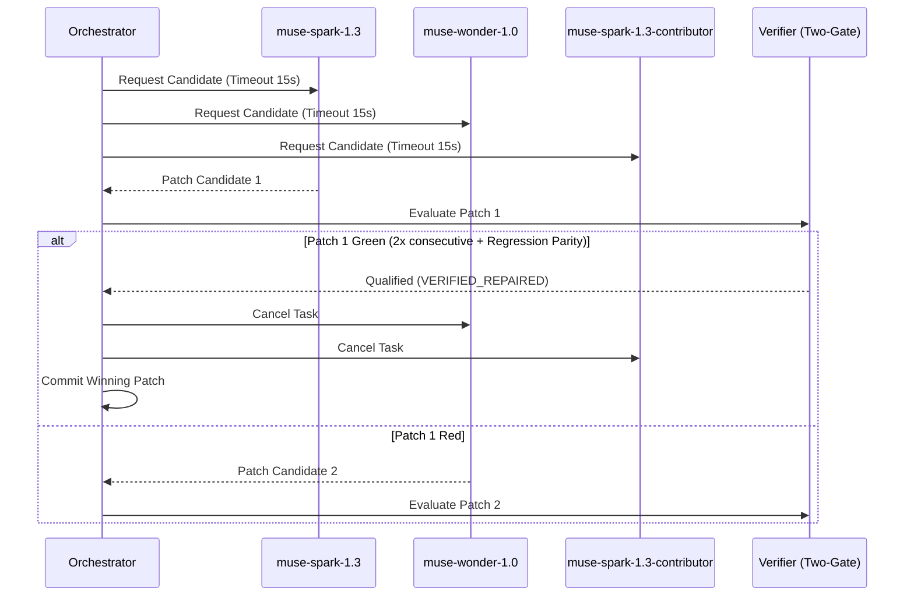

# Contract: Bounded Tri-Model Orchestration & Pooling

## 1. Allowed Model Pool
The authorized models for concurrent candidate generation are:
1. `muse-spark-1.3` (Primary lightweight fast-response candidate)
2. `muse-wonder-1.0` (Reasoning-heavy candidate for complex AST patches)
3. `muse-spark-1.3-contributor` (Alternative candidate with contributor persona)
4. Offline fallback test doubles for deterministic testing without external API requirements.

---

## 2. Competitive Race Protocol

---

## 3. Mandatory Limits & Accounting
- Max attempts per bug: 3 attempts.
- Max concurrent model tasks: 3 tasks.
- Per-task timeout: 15 seconds.
- Memory/scratch isolation: Each model writes patches to isolated in-memory buffers; disk application occurs strictly inside `ScratchSandbox`.
