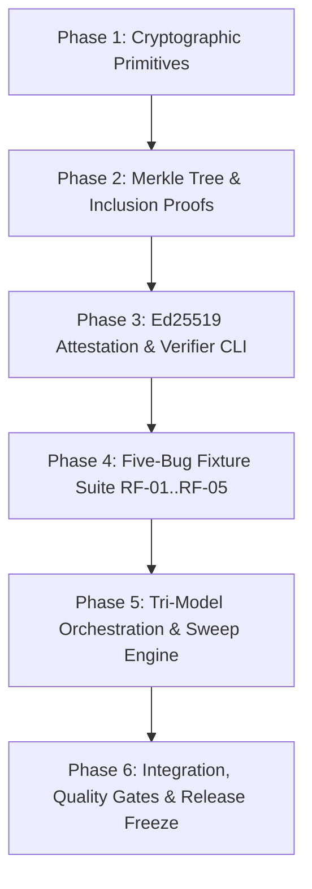

# 🏗️ Implementation Plan: Spec 090 — Cryptographic Merkle Receipts, Ed25519 Attestation, Five-Bug Sweep & Tri-Model Verification

## 1. Architectural Strategy & Sequence

This milestone is implemented across five decoupled, test-driven phases:

---

## 2. Technical Component Breakdown

### Component 1: Merkle Tree Engine (`replayfix_core::merkle`)
- Implementation of RFC 6962 tree construction with explicit domain separation (`0x00` leaf, `0x01` internal node).
- `MerkleTree`: builds balanced binary split trees, calculates root hash, generates audit path inclusion proofs.
- `MerkleProofVerifier`: validates audit path against expected root.

### Component 2: Ed25519 Cryptographic Attestation (`replayfix_core::crypto`)
- Pure Ed25519 signing and verification via `ed25519-dalek` with `zeroize` memory hygiene.
- `KeypairManager`: ephemeral key generation, PEM/hex secret key loading, and public key serialization.
- `AttestationPayload`: versioned canonical signing string `REPLAYFIX-ATTESTATION:v0.9:...`.
- `TrustPolicy`: verification against pinned trusted public keys.

### Component 3: Receipt Integration & Verification CLI (`replayfix_cli`)
- Wire Merkle tree generation into `AuditReceipt::write_disaggregated_artifacts`.
- CLI subcommand: `replayfix verify-receipt <path> [--trusted-key <hex>]`.

### Component 4: Authoritative Five-Bug Fixtures (`replayfix_core::fixtures`)
- Expand `Fixture::for_task` to support `RF-01`, `RF-02`, `RF-03`, `RF-04`, `RF-05`.
- Each with realistic buggy code, minimal unified diff fix, index HTML test page, and `BehavioralContract`.

### Component 5: Tri-Model Orchestration & Sweep Subcommand (`replayfix_cli::sweep`)
- `ModelPool`: concurrently queries up to 3 model candidates using Tokio tasks with cancellation tokens.
- Competitive race: first candidate passing preflight and sandbox verification wins; others cancelled.
- CLI subcommand: `replayfix sweep [--bugs ...] [--mock-heal] [--live-browser]`.
- Emits `.replayfix/sweep_receipt.json` with aggregate status and sub-60s execution benchmark.
