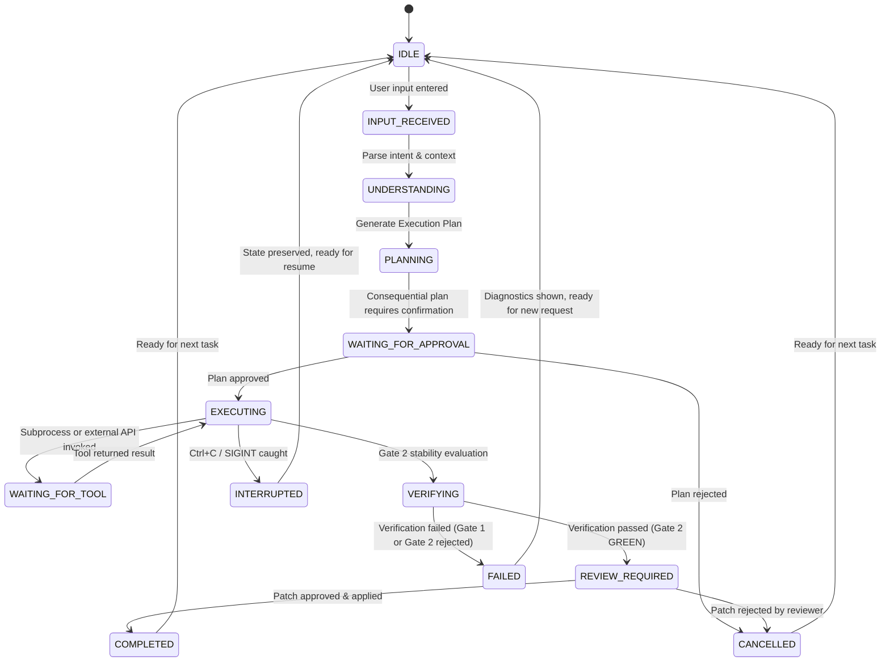

# Feature Specification: Spec 140 — Agent Experience Revolution (Release 1.4)

**Feature Branch**: `release/v1.4.0-agent-experience-revolution`  
**Created**: 2026-11-01  
**Status**: Ready for Planning & Implementation  
**Input**: Master Product Design & Engineering Directive /gstack way + speckit workflow for ReplayFix Release 1.4.

---

## 1. Executive Summary & Product Vision

Release 1.4 transforms **ReplayFix** from an expert-only CLI flag utility into a **human-centered, interactive Agentic Terminal Workspace** while maintaining 100% backward compatibility and uncompromising Substrate Primacy ([Constitution Law I](file:///d:/rouca/DVM/workPlace/replay_fix/.specify/memory/constitution.md#L9)).

Rather than expecting users to memorize complex command-line arguments (such as `replayfix repro --bug RF-01 --live-browser --headed --model muse-spark-1.3 --mode live-ai`), ReplayFix 1.4 provides:
1. **A Conversational Natural-Language Agent Shell**: Translates user goals and questions into validated verification manifests, explicit execution plans, and guided workflows.
2. **Transparent 13-State Agent Lifecycle**: Makes agent understanding, planning, waiting, execution, verification, and tool dispatch completely observable in real-time.
3. **Context-Aware Tiered Permission Engine**: Categorizes actions into Low, Medium, and High risk with granular explanations of why each action is needed and what resources are impacted.
4. **Interactive Hunk Review & Decision UI**: A keyboard-driven, in-terminal visual review interface with unified/side-by-side diff pagination, syntax highlighting, and selective acceptance.
5. **Real-Time Execution Feedback**: Live spinners, elapsed clocks, and phase progression cards that directly mirror substrate events without screen flicker or terminal buffer bloat.
6. **Persistent Session & Context Ergonomics**: Session checkpoint resumption, historical activity tracking, and non-destructive interruption (`Ctrl+C` safe recovery).

---

## 2. The 12 UX/AX Design Pillars Alignment

| Pillar | Requirement Summary | Architectural Expression in v1.4 |
| :--- | :--- | :--- |
| **P1: Conversational UX** | Natural language, continuity, contextual follow-ups, suggestions. | Interactive Agent REPL with intent parser, fuzzy command matching, and `/help`, `/plan`, `/repro`, `/diff`, `/doctor`, `/history`, `/exit` shortcuts. |
| **P2: Agent UX** | Explain intentions before action, observable tool calls, clear completions. | Two-stage "Plan-then-Execute" pipeline; explicit tool call inspection cards; honest model vs. substrate badges. |
| **P3: Permission & Approval** | Contextual approvals, risk tiers (Low/Med/High), policy configuration. | Risk-categorized approval prompts (`Allow Once`, `Allow for Session`, `Deny`); persistent audit logging. |
| **P4: Progress & Feedback** | Live observable phases, timers, tool status, no misleading progress. | Reactive rendering loop with active phase timers, spinner indicators, and discrete substrate status events. |
| **P5: Review & Decision** | Inspect diffs, see affected files, accept/reject, verification summaries. | Keyboard-navigable (`j/k`, `Tab`, `Space`, `Enter`) interactive patch previewer with syntax highlighting. |
| **P6: Context & State** | Active session visibility, context budget indicators, state recovery. | Session state manager integrated with `SessionStateCheckpoint` ([checkpoint.rs](file:///d:/rouca/DVM/workPlace/replay_fix/crates/replayfix-core/src/checkpoint.rs)); resume from disk. |
| **P7: Interaction Design** | Consistent visual hierarchy, predictable keybindings, focus indicators. | Terminal Component Library (`ui::terminal`): Cards, Dialogs, Tables, Prompt bars, and Status banners. |
| **P8: Error & Recovery** | Human-readable diagnostics, recovery suggestions, safe retry. | Actionable remediation tips, contextual retry prompts, and automatic preservation of triage reports. |
| **P9: Trust & Transparency** | Delineate model vs. substrate truth, visible security boundaries, Merkle receipts. | Live visual distinction between model proposals (purple/cyan) and substrate proofs (green/red); Merkle tree summary cards. |
| **P10: Session & Workflow** | Multi-task continuity, session summaries, clean shutdown. | Session workspace retaining multi-bug reproduction history, candidate patches, and verified receipts. |
| **P11: Terminal Ergonomics** | Keyboard-first, `SIGWINCH` resize handling, non-interactive CI fallback. | Window resize recalculation, viewport scroll bounding, automatic fallback to plain text stream when non-TTY. |
| **P12: Developer Experience** | Fast startup, self-documenting, rich diagnostics, clean error codes. | Onboarding welcome card, dynamic command completion hints, comprehensive `doctor` diagnostic cards. |

---

## 3. User Scenarios & Testing *(mandatory)*

### User Story 1 - Interactive Conversational Agent Shell (Priority: P1) 🎯 MVP

As a developer debugging a web application, I want to launch `replayfix` in interactive mode and describe my problem in plain English (e.g. *"Find and fix the cart quantity bug in metapulse"*), so that ReplayFix parses my intent, formulates a reproduction plan, and guides me through causal verification without requiring me to memorize CLI flags.

**Why this priority**: Core foundation of the v1.4 transformation. Turns a cold command-line utility into an intuitive, conversational agent.

**Independent Test**: Can be tested independently by launching the interactive shell (`replayfix` or `replayfix chat`), typing natural language instructions, and verifying that the agent parses the intent, builds a valid `TaskManifest`, presents a clear execution plan, and waits for user confirmation before executing.

**Acceptance Scenarios**:
1. **Given** a user runs `replayfix` with no arguments in an interactive terminal (TTY), **When** the application starts, **Then** it MUST display the Agentic Workspace welcome banner, system diagnostics summary, and an interactive conversational prompt `replayfix> `.
2. **Given** the user inputs `"reproduce and fix RF-01 in metapulse with live browser"`, **When** the intent parser runs, **Then** it MUST recognize task ID `RF-01`, target repo `metapulse`, live browser mode, and present a structured Execution Plan card outlining Gate 1 RED, bounded repair, and Gate 2 GREEN.
3. **Given** the user types an ambiguous or partial request (e.g. `"fix the checkout bug"`), **When** the agent evaluates it, **Then** it MUST present a polite contextual clarification with available matched bugs (`RF-01` to `RF-05`) instead of failing with an error.
4. **Given** a user runs ReplayFix in a non-interactive pipe or CI environment (`io::stdin().is_terminal() == false`), **When** `replayfix` executes, **Then** it MUST immediately fall back to standard non-interactive command processing without hanging.

---

### User Story 2 - Context-Aware Tiered Permission & Approval Gate (Priority: P2)

As a developer concerned with security and safety, I want ReplayFix to classify agent actions by risk level and request contextual approval with clear explanations, so that I maintain complete control over repository modifications and external network access.

**Why this priority**: Upholds Constitution Law III ($\Delta\text{repo} = 0$) and builds trust through transparent governance.

**Independent Test**: Can be tested by executing a plan that requires both dev-server spawning (Medium risk) and patch application to base repo (High risk), verifying that appropriate contextual dialogs appear with options to Approve Once, Approve for Session, or Deny.

**Acceptance Scenarios**:
1. **Given** an action classified as **Low Risk** (e.g. inspecting git status, reading repository files, extracting video frames), **When** the agent initiates it, **Then** it MUST proceed automatically with an informational execution event logged.
2. **Given** an action classified as **Medium Risk** (e.g. binding ephemeral port `:0` to boot a dev server, making an outbound HTTPS call to Meta AI API), **When** the agent requests execution, **Then** the UI MUST render an interactive Permission Dialog stating the target, purpose, and providing choices: `[a] Allow Once`, `[s] Allow for Session`, `[d] Deny`.
3. **Given** an action classified as **High Risk** (e.g. mutating the base repository by applying a verified patch), **When** reached, **Then** the UI MUST render a High-Risk Security Boundary Dialog showing modified files, insertions/deletions, SHA-256 digest, and require explicit affirmative confirmation (`[y] Yes / [n] No`).
4. **Given** a user rejects a permission request, **When** denied, **Then** the agent MUST gracefully cancel the operation, transition to `CANCELLED`, explain the refusal, and return to `IDLE` prompt without crashing.

---

### User Story 3 - Real-Time Dynamic Progress & Observable Feedback (Priority: P2)

As an engineer running a multi-minute reproduction and repair cycle, I want to see dynamic, in-place visual feedback (active phase, elapsed timer, current tool invocation, and terminal events), so that I know exactly what the agent is doing and never wonder if the process is hung.

**Why this priority**: Eliminates the "black box" feeling of long-running operations like FFmpeg processing, Playwright browser launches, and LLM reasoning.

**Independent Test**: Can be tested by running a live two-gate execution and verifying that the terminal status area updates in-place with phase transitions, animated activity indicator, elapsed milliseconds, and tool logs without scrolling off-screen or emitting duplicate lines.

**Acceptance Scenarios**:
1. **Given** an active operation is executing (e.g. Gate 1 CDP grounding or Muse repair), **When** the reactive UI renders, **Then** it MUST display an animated spinner, the active phase name (`PERCEPTION`, `GATE1_RED`, `MUSE_REPAIR`), and an elapsed timer (`[00:14s]`).
2. **Given** an operation transitions to the next phase (e.g. `Gate 1 RED` passed $\rightarrow$ `Bounded Repair` started), **When** the event fires, **Then** the previous phase row MUST transition to a permanent `[PASS]` badge and the new phase row becomes active.
3. **Given** an external tool or subprocess is invoked (e.g. `ffmpeg`, `playwright-cdp`, `node --check`), **When** invoked, **Then** an observable tool event badge `[TOOL: ffmpeg]` MUST appear with its runtime duration and exit status.

---

### User Story 4 - Interactive Hunk Diff & Decision Reviewer (Priority: P3)

As a code reviewer, I want an interactive in-terminal diff viewer where I can navigate file changes, inspect syntax-highlighted code additions/deletions, view anti-cheating test freeze verification, and make an informed decision before applying the patch, so that I can inspect repairs without switching to an external GUI.

**Why this priority**: Bridges the gap between automated patch synthesis and human operator sign-off.

**Independent Test**: Can be tested by generating a multi-line repair patch and launching the review dialog, verifying keyboard navigation (`j/k` scroll, `Tab` file switch, `a` approve, `r` reject).

**Acceptance Scenarios**:
1. **Given** a candidate patch is synthesized and verified by Gate 2 GREEN, **When** the agent transitions to `REVIEW_REQUIRED`, **Then** the interactive Diff Review component MUST open in the terminal viewport.
2. **Given** the diff review component is open, **When** the user presses `j` or `Down Arrow`, **Then** the diff viewport MUST scroll down smoothly, respecting terminal window height.
3. **Given** a multi-file patch, **When** the user presses `Tab`, **Then** the view MUST cycle between modified file tabs, displaying per-file stats (`+3 -1`).
4. **Given** the user presses `a` (or selects `[Approve & Apply]`), **When** confirmed, **Then** the patch MUST be applied to the base repository via `UnifiedPatcher::apply_to_worktree` and an audit record logged to `session_state.json`.

---

### User Story 5 - Persistent Session State, Resumption & Recovery (Priority: P3)

As a developer whose terminal session was closed or interrupted during a long sweep, I want ReplayFix to persist session state to disk and allow me to resume seamlessly, so that I don't lose completed verification work.

**Why this priority**: Prevents lost work, enables long-running workflows, and supports conversational continuity.

**Independent Test**: Can be tested by starting an interactive session, advancing past Gate 1 RED, killing or exiting the process, re-launching `replayfix resume`, and verifying that the session state restores to the exact stage with verified artifacts intact.

**Acceptance Scenarios**:
1. **Given** any phase transition in the agent lifecycle, **When** the phase completes, **Then** the session state MUST be written atomically to `.replayfix/session_state.json` conforming to `SessionStateCheckpoint`.
2. **Given** an interrupted session, **When** the user launches `replayfix resume` (or types `/resume` in the shell), **Then** ReplayFix MUST validate checkpoint freshness (matching git HEAD and manifest SHA-256) and restore the active session.
3. **Given** a checkpoint whose git HEAD or manifest digest differs from current workspace, **When** resume is attempted, **Then** ReplayFix MUST warn with `STALE_CHECKPOINT`, explain the invalidation, and offer to start a fresh session.

---

## 4. The 13-State Agent Interaction Lifecycle

The agent lifecycle models all operations through deterministic, observable semantic states:

### State Semantics & UI Representation

| State | Semantic Meaning | Terminal Feedback & Visual Presentation |
| :--- | :--- | :--- |
| `IDLE` | Waiting for user command or natural language input. | Prompt bar with active session info: `replayfix [main] > ` |
| `INPUT_RECEIVED` | Prompt received, echoing input. | User message card with timestamp and prompt text. |
| `UNDERSTANDING` | Resolving task ID, repo path, video, and environment. | Subtle pulsating indicator: `Understanding request...` |
| `PLANNING` | Constructing execution plan. | Formatted Plan Card with steps, risks, and estimated duration. |
| `WAITING_FOR_APPROVAL`| Awaiting operator decision on plan or permission. | Interactive selection dialog: `[a] Approve  [m] Modify  [c] Cancel` |
| `EXECUTING` | Running substrate verification steps. | Active step indicator with spinner and elapsed timer. |
| `WAITING_FOR_TOOL` | Subprocess active (`ffmpeg`, Playwright CDP, Meta AI). | Tool badge showing executable name and running time. |
| `VERIFYING` | Running Gate 2 stability passes & regression check. | Parity card showing consecutive run counters `[1/2] -> [2/2]`. |
| `REVIEW_REQUIRED` | Patch verified; awaiting human review. | Diff Reviewer component with interactive keystroke controls. |
| `COMPLETED` | Task successfully completed, artifacts written. | Success Banner, Merkle Root summary, and audit receipt link. |
| `FAILED` | Gate failure, quarantine, or regression detected. | Failure Diagnostic Card with root cause and suggested fix. |
| `CANCELLED` | Action rejected by user or policy. | Warning note: `Action aborted by operator. Repository untouched.` |
| `INTERRUPTED` | `Ctrl+C` caught safely. | Recovery note: `Execution safely paused. Session checkpoint saved.` |

---

## 5. Terminal Design System & Interaction Specifications

### 5.1 Color and Semantic Tokens
- **Brand / Accent**: `Bold Cyan` (`\x1b[1;36m`) — Prompt symbols, headers, and ReplayFix badges.
- **Success / Truth**: `Bold Green` (`\x1b[1;32m`) — Substrate proofs, verified gates, added diff lines.
- **Warning / Attention**: `Bold Yellow` (`\x1b[1;33m`) — Medium-risk permissions, non-blocking notices.
- **Error / Failure**: `Bold Red` (`\x1b[1;31m`) — Rejections, removed diff lines, security alerts.
- **Agent Reasoning**: `Bold Magenta` (`\x1b[1;35m`) — Model intentions, planning deliberations.
- **Muted / Subdued**: `Dim Gray` (`\x1b[2m`) — Borders, timestamps, file paths, unselected options.

### 5.2 Keybinding Conventions
- `Enter`: Submit prompt / Confirm default selection.
- `Up` / `Down` or `k` / `j`: Navigate menu items or scroll diff viewport.
- `Tab`: Cycle focus between input, tabs, or dialog actions.
- `Space`: Toggle selection (multi-select) or advance diff page.
- `Esc` / `q`: Cancel active dialog / Return to `IDLE` prompt.
- `Ctrl+C`: Safe non-destructive interruption (saves checkpoint).
- `Ctrl+L`: Clear screen while preserving active session status bar.

---

## 6. Functional Requirements

- **FR-001 (Conversational REPL)**: The system MUST provide an interactive conversational shell when invoked with no subcommand in an interactive TTY, or via `replayfix chat`.
- **FR-002 (Natural Language Intent Parsing)**: The system MUST parse natural language user requests to extract task identifiers, repository targets, execution modes, and models, falling back to contextual clarification when ambiguous.
- **FR-003 (Plan Formulation & Review)**: The agent MUST present an explicit execution plan card prior to initiating any execution or subprocess.
- **FR-004 (Tiered Risk Model)**: The system MUST categorize every agent action into Low, Medium, or High risk and enforce matching permission gates.
- **FR-005 (Permission Decision Persistence)**: The system MUST allow users to grant permissions on an `Allow Once` or `Allow for Session` basis, logging all decisions to `session_state.json`.
- **FR-006 (Real-Time Reactive Rendering)**: The terminal UI MUST update active execution phases, spinners, elapsed timers, and tool events in-place without screen tearing or duplicate lines.
- **FR-007 (Interactive Diff Reviewer)**: The system MUST provide a scrollable, syntax-highlighted in-terminal diff viewer with file tabs and hunk navigation for reviewing candidate patches.
- **FR-008 (Session State Persistence)**: The system MUST persist active session progress to `.replayfix/session_state.json` on every state transition and support resumption via `replayfix resume` or `/resume`.
- **FR-009 (Terminal Resize Safety)**: The terminal UI MUST gracefully recalculate layouts and constrain scrolling upon window resize events (`SIGWINCH` / console size change).
- **FR-010 (100% Non-Interactive Backward Compatibility)**: All existing CLI commands (`repro`, `doctor`, `freeze-spec`, `verify-receipt`, `sweep`, `export-proof`), flags, and exit codes MUST remain completely functional for non-interactive execution.
- **FR-011 (Substrate Truth Integrity)**: The UI MUST never display synthetic, simulated, or faked execution states; every status badge and progress indicator MUST derive directly from real substrate events.

---

## 7. Success Criteria

- **SC-001 (Zero-Command Onboarding)**: 100% of standard reproduction and repair workflows (e.g. reproducing RF-01 on MetaPulse) can be initiated through conversational English without typing flags.
- **SC-002 (Accidental Mutation Prevention)**: 0% unapproved base repository mutations; High-Risk patch application requires explicit human review and confirmation.
- **SC-003 (Live Feedback Latency)**: Status and spinner updates in the terminal UI render within $\le 50\text{ ms}$ of actual substrate events.
- **SC-004 (Full Test & Clippy Parity)**: All 241 existing tests continue to pass with 0 regressions, and the entire workspace compiles with 0 warnings under `cargo clippy --workspace --all-targets -- -D warnings`.
- **SC-005 (Terminal Robustness)**: The interactive terminal UI functions cleanly across standard dimensions ($80 \times 24$ minimum, $120 \times 40$ recommended) without panic or uncontrolled stdout buffer flooding.

---

## 8. Assumptions & Boundaries

- **Target OS**: Cross-platform support for Windows, Linux, and macOS.
- **Terminal Capabilities**: ANSI-capable terminal with UTF-8 support; automatic plain-text ASCII fallback for dumb terminals or redirected streams.
- **Execution Boundary**: Substrate core logic remains synchronous and deterministic in `replayfix-core`; the interactive CLI event loop in `replayfix-cli` coordinates rendering and user input asynchronously or via non-blocking terminal polling.
- **Dependencies**: Keep dependencies lightweight and project-native, avoiding heavy foreign runtimes (Node.js/Ink, Python) or complex C bindings. Use idiomatic Rust terminal crates (`crossterm`) to provide cross-platform raw mode, keyboard event polling, and alternate screen buffers.