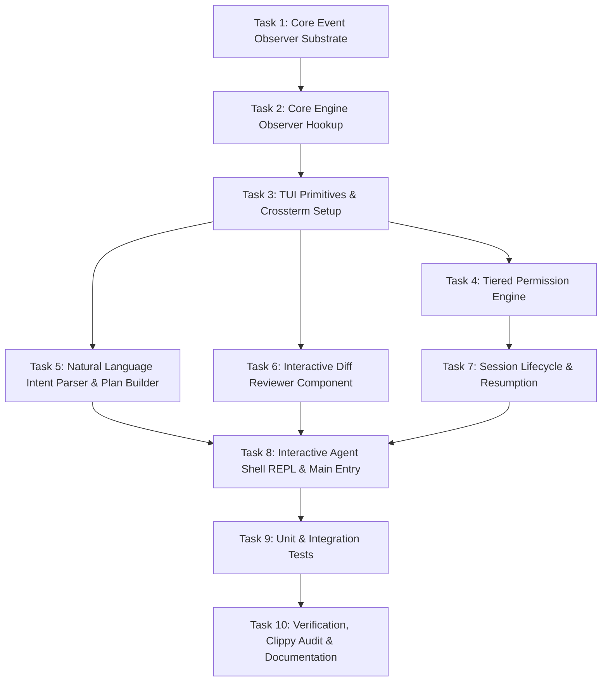

# Tasks: Spec 140 — Agent Experience Revolution (Release 1.4)

**Branch**: `release/v1.4.0-agent-experience-revolution` | **Spec**: [spec.md](./spec.md) | **Plan**: [plan.md](./plan.md)  
**Status**: Ready for Implementation  
**Methodology**: Elephant Carpaccio Vertical Slices, BeautifulRust Discipline

---

## Task Overview & Dependency Graph

---

## Detailed Task Specifications

### [x] Task 1: Core Substrate Event Observer
- **Files**: `crates/replayfix-core/src/observer.rs`, `crates/replayfix-core/src/lib.rs`
- **Goal**: Implement `SubstrateEvent` enum, `SubstrateObserver` trait, and thread-safe event broadcaster (`BroadcastObserver`, `NullObserver`).
- **Invariants**: `#![forbid(unsafe_code)]`, zero panics, serde serializable events.
- **Verification**: Core unit test verifying event serialization and observer broadcast.

### [x] Task 2: Core Engine Observer Integration
- **Files**: `crates/replayfix-core/src/engine.rs`
- **Goal**: Connect `SubstrateObserver` hooks into `MockHealer` execution paths (Phase start/stop, Gate 1 start/verdict, Repair attempt/syntax, Gate 2 start/verdict).
- **Invariants**: Preserve exact existing behavior and function signatures when observer is `None` or defaulted.
- **Verification**: Existing 194 core tests continue to pass 100%.

### [x] Task 3: Terminal UI Primitives & Crossterm Dependency
- **Files**: `crates/replayfix-cli/Cargo.toml`, `crates/replayfix-cli/src/tui/mod.rs`, `crates/replayfix-cli/src/tui/screen.rs`, `crates/replayfix-cli/src/tui/spinner.rs`
- **Goal**: Add `crossterm = "0.28"`. Implement raw mode screen guard, terminal resize handling, and lightweight 30 FPS progress spinner with elapsed timer.
- **Invariants**: Clean terminal restoration on drop or panic (`Drop` implementation).
- **Verification**: Headless screen initialization and drop tests.

### [x] Task 4: Context-Aware Tiered Permission Engine
- **Files**: `crates/replayfix-cli/src/permissions.rs`, `crates/replayfix-cli/src/tui/dialog.rs`
- **Goal**: Implement `RiskLevel` (Low, Medium, High), `PermissionAction`, `PermissionPolicy`, and interactive approval dialogs (`AllowOnce`, `AllowSession`, `Deny`).
- **Invariants**: High-risk patch application requires explicit confirmation; non-interactive sessions fail closed without `--yes`.
- **Verification**: Unit tests verifying policy evaluation, session-level caching, and rejection semantics.

### [x] Task 5: Natural Language Intent Parser & Plan Builder
- **Files**: `crates/replayfix-cli/src/intent.rs`
- **Goal**: Parse conversational user inputs into `AgentIntent` (`reproduce`, `fix`, `doctor`, `sweep`, `receipt`, `help`, `status`, `exit`). Construct structured `ExecutionPlan` with task cards, steps, and risk levels.
- **Invariants**: Case-insensitive, robust to whitespace and typos, supports contextual follow-up.
- **Verification**: Unit tests covering 20+ natural language prompt variations.

### [x] Task 6: Interactive Diff Reviewer Component
- **Files**: `crates/replayfix-cli/src/tui/diff_view.rs`
- **Goal**: Implement keyboard-driven (`j`/`k`, `Tab`, `a`, `r`) virtualized diff viewer with syntax highlighting and hunk scrolling.
- **Invariants**: Safe against ANSI injection; handles arbitrary diff lengths within terminal viewport bounds.
- **Verification**: Diff navigation tests verifying scrolling bounds and approval keypresses.

### [x] Task 7: Session Lifecycle & Resumption
- **Files**: `crates/replayfix-cli/src/session.rs`
- **Goal**: Track conversational turns, active task context, permission decisions, and link to `SessionStateCheckpoint`. Support session save and resume.
- **Invariants**: Atomic write to `.replayfix/session_state.json`; reject stale sessions where HEAD or manifest digest drifted.
- **Verification**: Session roundtrip persistence and freshness verification tests.

### [x] Task 8: Interactive Agent Shell REPL & CLI Main Entry
- **Files**: `crates/replayfix-cli/src/shell.rs`, `crates/replayfix-cli/src/main.rs`
- **Goal**: Implement interactive REPL loop coordinating prompt input, plan review, reactive progress display, and review dialogs. Update `main.rs` to launch interactive shell when invoked with no subcommand in an interactive TTY.
- **Invariants**: 100% backward compatibility for all existing subcommands and flags. Non-interactive CLI runs bypass shell.
- **Verification**: CLI integration tests ensuring existing flags (`replayfix doctor`, `replayfix repro --bug RF-01`) behave identically.

### [x] Task 9: Unit & Integration Test Suite
- **Files**: `crates/replayfix-cli/tests/agent_ux.rs`
- **Goal**: Comprehensive integration test suite covering conversational intent, tiered permissions, interactive review, and session resumption.
- **Invariants**: All tests must run cleanly in CI without hanging.
- **Verification**: `cargo test --workspace` passes all tests.

### [x] Task 10: Verification, Clippy Audit & Documentation
- **Files**: `CHANGELOG.md`, `README.md`, `ROADMAP.md`
- **Goal**: Run `cargo clippy --workspace --all-targets -- -D warnings`, format with `cargo fmt`, update documentation with Release 1.4 Agent Experience guides, and produce final feature acceptance traceability matrix.
- **Invariants**: Zero compiler warnings, zero Clippy warnings, documentation integrity.
- **Verification**: Warning-free build and clean test suite.